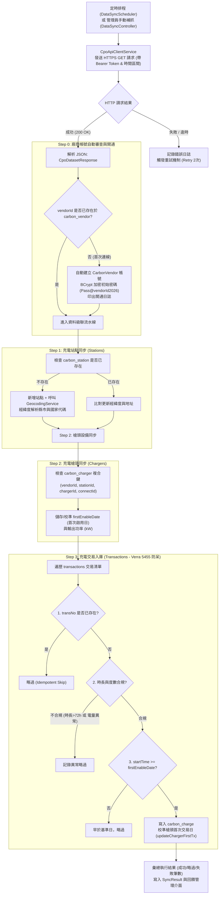

# 台灣電動車充電系統碳權專案 (Verra 5455)
# CPO 單一數據查詢 API 介接 — 平台端改造開發計畫書

| 專案資訊 | 內容說明 |
| :--- | :--- |
| **文件名稱** | 上威智碳權平台（TEVCS）外部 CPO 單一 API 介接架構改造計畫 |
| **版本 / 日期** | v1.1 ｜ 2026 年 11 月 |
| **負責團隊** | 碳權平台後端研發小組 |
| **主要目標** | 淘汰跨庫 DB 直連，改採主動 HTTP REST API 增量拉取；實現業者帳號自動開通與三層級聯合規入庫 |

---

## 1. 背景與改造目標

### 1.1 現況痛點 (Current Legacy Architecture)
目前平台之外部數據同步模組（`DataSyncServiceImpl`）採用 JDBC 直連外部資料庫 View / Table（`ccms.trans_mapping`）：
1. **安全與網路限制**：要求業者開放外部資料庫 Port（如 3306/5432）及 DB 帳密，容易遭受外部業者資安團隊否決。
2. **架構耦合度高**：外部 DB 欄位或結構一經異動，底層 SQL 即刻中斷。
3. **資料缺損風險**：目前僅同步交易明細，若業者尚未於平台建立站點或充電樁，易造成資料關聯不完整。
4. **手動開通繁瑣**：新業者加入時需人工手動至資料庫或後台註冊帳號，影響上線效率。

### 1.2 改造目標 (Key Deliverables)
1. **單一端點整合 (Single API Ingestion)**：由我方定時向業者呼叫單一端點（`GET /api/v1/carbon/dataset`），一次取得 `stations`（站點）、`chargers`（槍頭）與 `transactions`（充電交易）。
2. **帳號自動開通 (Vendor Auto-Provisioning)**：首次成功自 API 拉取到未建檔的 `vendorId` 時，系統自動註冊 `CarbonVendor` 帳號並派發初始安全密碼，達成零人工作業。
3. **階層式級聯合規入庫 (3-Tier Cascade Ingestion)**：依序自動建置站點（整合逆地理編碼）、設備槍頭（同步基準日 `firstEnableDate`）與交易明細（遵循 Verra 5455 防呆）。
4. **靈活排程與補抓機制 (Incremental & Manual Repull)**：排程自動增量拉取（Watermark Buffer），並提供管理後台可指定時間區間手動補抓的功能。

---

## 2. 系統架構與業務流程

### 2.1 整體架構流程圖



---

## 3. 模組改造詳細設計

### 3.1 模組一：設定檔與連線配置 (`SyncConfig.java` & `application.yml`)
支援以多業者為單位的 API 端點與連線屬性管理：

```yaml
# application-sit.yml / application-prod.yml
sync:
  enabled: true
  cron: "0 */15 * * * ?"       # 每 15 分鐘增量拉取一次
  buffer-minutes: 5            # 往前多抓 5 分鐘 Buffer 防止網路延遲掉單
  default-page-size: 1000
  cpo-sources:
    - vendor-id: "TAIPEI_EV"
      name: "台北充電營運"
      api-url: "https://cpo-sit.example.com/api/v1/carbon/dataset"
      token: "secret_bearer_token_cpo1"
      enabled: true
      connect-timeout-ms: 5000
      read-timeout-ms: 30000
```

### 3.2 模組二：傳輸資料物件 (DTO Layer)
建立專用傳輸物件套件 `com.carbon.api.dto.external.cpo`：
* `CpoDatasetResponse.java`：封裝 `resultCode`、`resultMsg`、`vendorId` 與 `data`。
* `CpoDatasetData.java`：包含 `List<CpoStationDto>`、`List<CpoChargerDto>`、`List<CpoTransactionDto>`。
* `CpoStationDto.java`：`stationId`, `stationName`, `gpsLatitude`, `gpsLongitude`, `address`。
* `CpoChargerDto.java`：`stationId`, `chargerId`, `connectId`, `firstEnableDate`, `chargerType`, `chargerKw`。
* `CpoTransactionDto.java`：`transNo`, `stationId`, `chargerId`, `connectId`, `startTime`, `endTime`, `kwh`, `carType`, `carNo`, `invoiceNo`。

### 3.3 模組三：HTTP Client 服務層 (`CpoApiClientService.java`)
* 基於 Spring `RestTemplate`（配置連線池與 Timeouts）。
* **自動分頁迴圈拉取**：若當次回傳的交易筆數達到 `pageSize`，自動遞增 `page` 繼續發送請求，直到拉取完整區間的數據。
* 具備連線失敗重試（Retry 2 次）與詳細 HTTP 錯誤狀態碼紀錄。

### 3.4 模組四：廠商帳號自動建置 (Vendor Auto-Provisioning)
在處理資料前先檢核廠商是否存在：
```java
public void ensureVendorExists(String vendorId) {
    if (vendorRepository.findByVendorId(vendorId) == null) {
        CarbonVendor newVendor = new CarbonVendor();
        newVendor.setVendorId(vendorId);
        // 自動生成安全初始密碼：Pass@{vendorId}2026!
        String initialPassword = "Pass@" + vendorId + "2026!";
        newVendor.setPassword(passwordEncoder.encode(initialPassword));
        newVendor.setStatus("1"); // 預設啟用
        newVendor.setRole("ROLE_USER");
        newVendor.setCreateTime(LocalDateTime.now().format(formatter));
        newVendor.setUpdateTime(LocalDateTime.now().format(formatter));
        vendorRepository.save(newVendor);
        
        log.warn("=== [Auto-Provisioning] 新業者帳號自動建立成功 ===");
        log.warn("業者代號 (Vendor ID): {}", vendorId);
        log.warn("預設登入密碼: {}", initialPassword);
        log.warn("================================================");
    }
}
```

### 3.5 模組五：數據級聯整合與合規檢核流水線 (`DataSyncServiceImpl.java`)
將原有的 SQL 查詢替換為三層級聯流水線：
1. **站點處理**：
   - 呼叫 `stationRepository.findByVendorIdAndStationId`。
   - 若為新站點，調用 `geocodingService.reverseGeocode()` 補齊縣市行政區並寫入。
2. **槍頭處理**：
   - 呼叫 `chargerRepository.findByVendorIdAndStationIdAndChargerIdAndConnectId`。
   - 確保 `firstEnableDate` 與輸出功率更新。
3. **交易合規檢核 (Verra 5455)**：
   - 檢查 `transNo` 是否存在（存在則略過，確保防重冪等）。
   - 時長防呆（$0 < \text{duration} \le 72\text{ 小時}$）。
   - 電量防呆（$0.01 \le \text{kwh} \le 1000.00\text{ kWh}$）。
   - 基準日防呆（$startTime \ge firstEnableDate$）。
   - 寫入 `CarbonCharge`，並自動觸發 `updateChargerFirstTransactionTime`。

### 3.6 模組六：排程調度與手動介面 (`DataSyncScheduler` & `DataSyncController`)
* **定時排程**：每 15 分鐘執行一次，自動以 `[現在 - 20分鐘, 現在]` 作為增量區間，自動拉取所有在 YAML 中啟用 (`enabled: true`) 的 CPO。
* **手動補抓 API**：
  - `POST /api/sync/pull`
  - 參數：`vendorId`（選填，未填則全抓）、`startTime`、`endTime`（必填）。
  - 管理員於後台點選時可自由補抓歷史遺漏資料。

---

## 4. 實施階段與工作時程表 (Roadmap)

```
┌──────────────────────────────────────────────────────────────────────────┐
│ [Phase 1] 基礎架構與配置準備 (預估工時: 0.5 天)                                  │
│  - 建立 CpoDatasetResponse 等 5 個 DTO 類別                               │
│  - 擴充 SyncConfig.java 支援 cpo-sources 配置清單                           │
└────────────────────────────────────┬─────────────────────────────────────┘
                                     ▼
┌──────────────────────────────────────────────────────────────────────────┐
│ [Phase 2] HTTP Client 與帳號自動開通 (預估工時: 1 天)                         │
│  - 實作 CpoApiClientService (RestTemplate + 分頁迴圈 + 重試)               │
│  - 實作 ensureVendorExists() 自動開通 CarbonVendor 帳號與密碼加密            │
└────────────────────────────────────┬─────────────────────────────────────┘
                                     ▼
┌──────────────────────────────────────────────────────────────────────────┐
│ [Phase 3] 三層級聯入庫與 Verra 5455 防呆 (預估工時: 1.5 天)                   │
│  - 重構 DataSyncServiceImpl.syncFromCpoApi() 流水線                       │
│  - 整合 GeocodingService、Charger 基準日檢核與交易防呆                      │
│  - 撰寫單元測試 (Mock CPO API 驗證冪等性、時長檢核與跳過邏輯)                  │
└────────────────────────────────────┬─────────────────────────────────────┘
                                     ▼
┌──────────────────────────────────────────────────────────────────────────┐
│ [Phase 4] 排程、手動 API 與雙向聯測 (預估工時: 1 天)                          │
│  - 升級 DataSyncController (支援手動依時間補抓端點)                          │
│  - 更新 DataSyncScheduler 增量時間窗口排程                                  │
│  - 與業者 SIT 環境執行端到端 (E2E) 聯測驗收                                  │
└──────────────────────────────────────────────────────────────────────────┘
```

---

## 5. 風險管理與相容性保障

1. **資料庫向下相容性**：
   - 現有資料庫結構（`carbon_station`, `carbon_charger`, `carbon_charge`, `carbon_vendor`）完全不需結構性變更（DDL 不需更動），新舊機制平滑過渡。
2. **舊版 DB Sync 開關保全**：
   - 原有的 DB 直連功能保留為 Legacy 備用開關（`sync.legacy-db.enabled: false`），隨時可依需求應急切換。
3. **分頁記憶體保護**：
   - 針對單次拉取超過 5,000 筆之極端資料量，HTTP Client 採批次處理並立即存檔清空緩存，避免 JVM Out-Of-Memory (OOM)。
